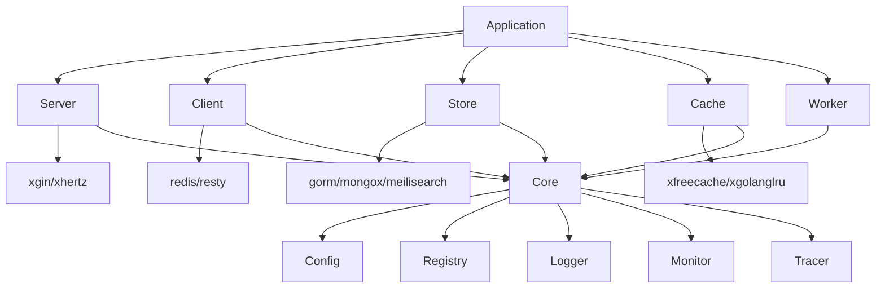

# Jupiter 核心概念

本文档介绍 Jupiter 微服务框架的核心概念、架构设计和设计原则，帮助开发者理解框架的基本理念和使用方式。

## 概述

Jupiter 是一个企业级微服务框架，基于 Go 1.23.0 开发，提供了完整的微服务开发解决方案。框架遵循"约定优于配置"的设计理念，通过合理的默认配置和灵活的扩展机制，帮助开发者快速构建高性能、高可用的微服务应用。

## 架构设计

### 整体架构

Jupiter 框架采用分层架构设计，从上到下分为以下几个层次：

```
┌─────────────────────────────────────────────────────────┐
│                    应用层 (Application)                    │
├─────────────────────────────────────────────────────────┤
│                    服务层 (Service)                       │
├─────────────────────────────────────────────────────────┤
│                  组件层 (Component)                       │
├─────────────────────────────────────────────────────────┤
│                   核心层 (Core)                          │
└─────────────────────────────────────────────────────────┘
```

- **应用层**：开发者编写的业务代码，包括 HTTP/gRPC 处理器、业务逻辑等
- **服务层**：框架提供的服务器实现，如 HTTP、gRPC 服务器
- **组件层**：各种功能组件，如数据库、缓存、消息队列等
- **核心层**：框架核心功能，包括配置管理、日志、监控、生命周期管理等

### 核心组件

Jupiter 框架由以下核心组件构成：



## 设计原则

### 1. 约定优于配置

Jupiter 框架通过合理的默认配置，减少开发者的配置工作：

```go
// 使用默认配置创建服务器
ginServer := xgin.Default()

// 使用默认配置创建数据库连接
db := gorm.StdConfig("mysql").Build()
```

### 2. 组件化设计

框架采用组件化设计，各组件职责单一，可以独立使用：

```go
// 只使用日志组件
logger := xlog.Jupiter()
logger.Info("Hello, Jupiter!")

// 只使用配置组件
conf.LoadFromFile("config.toml")
```

### 3. 依赖注入

框架支持依赖注入，简化组件之间的依赖关系：

```go
// 通过配置自动注入依赖
type UserService struct {
    db    *gorm.DB
    cache cache.Cache
}

func NewUserService(db *gorm.DB, cache cache.Cache) *UserService {
    return &UserService{
        db:    db,
        cache: cache,
    }
}
```

### 4. 生命周期管理

框架提供完整的生命周期管理，确保资源的正确初始化和释放：

```go
app := jupiter.New()
app.Serve(ginServer)
app.Schedule(worker)

// 启动应用，自动管理所有组件的生命周期
app.Run()
```

## 核心概念

### 应用 (Application)

应用是 Jupiter 框架的顶层概念，代表一个完整的微服务实例。应用负责管理所有组件的生命周期，并提供统一的启动和关闭机制。

```go
// 创建应用
app := jupiter.New(jupiter.WithConfigFile("config.toml"))

// 注册服务器
app.Serve(ginServer)

// 启动应用
if err := app.Run(); err != nil {
    panic(err)
}
```

### 服务器 (Server)

服务器是应用的网络入口，负责处理客户端请求。Jupiter 支持多种服务器实现：

- **HTTP 服务器**：基于 Gin、Echo、FastHTTP 等
- **gRPC 服务器**：基于 gRPC 框架
- **Governor 服务器**：提供管理接口

```go
// 创建 Gin 服务器
ginServer := xgin.Default(
    xgin.WithHost("0.0.0.0"),
    xgin.WithPort(8080),
)

// 注册路由
ginServer.GET("/health", func(c *gin.Context) {
    c.JSON(200, gin.H{"status": "ok"})
})

// 将服务器注册到应用
app.Serve(ginServer)
```

### 客户端 (Client)

客户端是应用访问外部服务的组件，包括数据库、缓存、消息队列等：

```go
// 创建 Redis 客户端
redisClient := redis.StdConfig("default").Build()

// 创建 gRPC 客户端
grpcClient := grpc.StdConfig("user-service").Build()
```

### 存储 (Store)

存储组件提供数据持久化能力，支持多种数据库：

```go
// 使用 GORM 连接 MySQL
db := gorm.StdConfig("mysql").Build()

// 使用 MongoDB
mongo := mongox.StdConfig("mongo").Build()

// 使用 Typesense 搜索引擎
typesense := typesense.StdConfig("search").Build()
```

### 缓存 (Cache)

缓存组件提供内存缓存能力，支持多种缓存实现：

```go
// 使用 FreeCache
cache := xfreecache.New(100 * 1024 * 1024) // 100MB

// 使用 LRU Cache
cache := xgolanglru.New(1000)
```

### 工作队列 (Worker)

工作队列组件提供异步任务处理能力：

```go
// 创建工作队列
worker := worker.NewQueue("email", worker.WithQueueSize(1000))

// 添加任务
worker.Push(&EmailTask{
    To:      "user@example.com",
    Subject: "Welcome",
    Body:    "Welcome to Jupiter!",
})
```

## 配置系统

Jupiter 框架提供统一的配置系统，支持多种数据源和格式：

### 配置结构

配置采用分层结构，支持环境覆盖：

```toml
# 基础配置
[app]
name = "example-service"
region = "default"
zone = "default"

# 开发环境配置
[app.dev]
env = "development"

# 生产环境配置
[app.prod]
env = "production"
```

### 配置加载

配置可以通过多种方式加载：

```go
// 从文件加载
conf.LoadFromFile("config.toml")

// 从环境变量加载
conf.LoadFromEnv()

// 从 etcd 加载
conf.LoadFromEtcd("config/key")
```

## 错误处理

Jupiter 框架提供统一的错误处理机制：

```go
// 创建错误
err := xerror.New(xerror.InvalidArgument, "用户名不能为空")

// 添加上下文信息
err = err.WithMsg("用户名长度必须大于6个字符")

// 添加数据
err = err.WithData(map[string]interface{}{
    "field": "username",
    "min":   6,
})
```

## 日志系统

Jupiter 框架提供结构化日志系统：

```go
// 获取日志器
logger := xlog.Jupiter()

// 记录日志
logger.Info("处理请求",
    xlog.String("method", "GET"),
    xlog.String("path", "/api/users"),
    xlog.Duration("cost", time.Since(start)),
)
```

## 监控与追踪

Jupiter 框架集成监控和链路追踪功能：

```go
// 记录指标
counter := metric.NewCounter("http_requests_total")
counter.Inc()

// 记录直方图
histogram := metric.NewHistogram("http_request_duration")
histogram.Observe(duration)

// 创建 Span
ctx, span := tracer.Start(ctx, "http_request")
defer span.End()
```

## 总结

Jupiter 框架通过合理的架构设计和丰富的功能组件，为微服务开发提供了完整的解决方案。理解这些核心概念，有助于更好地使用框架，构建高质量的微服务应用。

## 下一步

- 了解 [配置系统](./config.md)
- 学习 [服务器组件](./servers.md)
- 探索 [客户端组件](./clients.md)
- 查看 [存储组件](./stores.md)