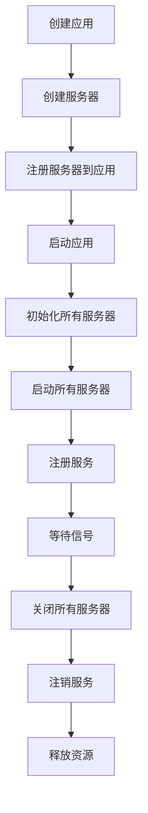

# Jupiter 服务器组件

本文档详细介绍 Jupiter 框架中的各种服务器组件，包括 HTTP 服务器和管理服务器等，以及它们的使用方法和配置选项。

## 概述

Jupiter 框架提供了多种服务器实现，支持不同的协议和框架。服务器组件是微服务应用的网络入口，负责处理客户端请求，并返回响应。框架提供了统一的接口和配置方式，简化了服务器的创建和管理。

## HTTP 服务器

### Gin 服务器 (xgin)

Gin 是一个高性能的 HTTP Web 框架，Jupiter 对其进行了封装，提供了开箱即用的配置和功能。

#### 基本使用

```go
// 创建 Gin 服务器
ginServer := xgin.StdConfig("http").MustBuild()

// 注册路由
ginServer.GET("/health", func(c *gin.Context) {
    c.JSON(200, gin.H{"status": "ok"})
})

// 将服务器注册到应用
app.Serve(ginServer)
```

#### 配置选项

```toml
# Gin 服务器配置
[server.http]
host = "0.0.0.0"
port = 8080
mode = "release"                      # debug, release, test
disableMetric = false
slowQueryThresholdInMilli = 500
serviceAddress = ""                   # 注册信息中上报的地址，默认 host:port

# 超时控制（0 表示不限制；readTimeout 同时用作读 header 超时）
readTimeout = "30s"
writeTimeout = "30s"
idleTimeout = "60s"

# TLS：certFile 与 keyFile 任一非空即启用 HTTPS，证书在构建期加载校验
certFile = ""
keyFile = ""

# 优雅停止排空超时（0 表示沿用调用方传入 ctx 的期限）
shutdownTimeout = "5s"

# CORS 默认开启且全部授权；如需关闭可设 disableCORS = true
disableCORS = false
[server.http.cors]
allowAllOrigins = true
allowMethods = ["GET", "POST", "PUT", "PATCH", "DELETE", "HEAD", "OPTIONS"]
allowHeaders = ["Origin", "Content-Length", "Content-Type", "Authorization", "X-Requested-With", "AID"]
exposeHeaders = ["Content-Length"]
allowCredentials = false
maxAge = "12h"
```

xgin 默认使用 `github.com/gin-contrib/cors` 注册 CORS 中间件，默认允许所有来源。若需要按域名收敛，可在 `[server.http.cors]` 中关闭 `allowAllOrigins` 并配置 `allowOrigins`。

xgin 的 access/recover 日志通过 jupiter `xlog` 输出；同时构建服务器时会接管 `gin.DefaultWriter` 与 `gin.DefaultErrorWriter`，使 Gin 自身的 debug/warning/error 输出也进入 jupiter 日志管道。

#### WebSocket

xgin 内置基于 gorilla/websocket 的升级封装，`WebSocketOptions` 创建升级器后经 `Server.Upgrade` 注册路由：

```go
ginServer := xgin.StdConfig("http").MustBuild()

ws := xgin.WebSocketOptions("/ws", func(conn xgin.WebSocketConn, err error) {
    if err != nil {
        return
    }
    for {
        msgType, msg, readErr := conn.ReadMessage()
        if readErr != nil {
            return
        }
        conn.WriteMessage(msgType, msg) // echo
    }
})
ginServer.Upgrade(ws)
```

升级器即 gorilla 的 `*websocket.Upgrader`，可直接设置 `CheckOrigin`、`Subprotocols`、`EnableCompression` 等字段控制握手行为。

#### return 风格 handler（H 包装器）

原生注册方式不变；需要用 `return` 直接返回响应时，用 `xgin.H` 包装 handler：

```go
// 形态一：H 嵌套，handler 用 return 直接返回
func OfficialCheck(c *gin.Context) xgin.String {
    return xgin.NewString(200, "测试")
}
g.GET("/official", H(OfficialCheck))
g.GET("/menu/my", H(adminHandler.MenuMy))

// 形态二：原生写法，直接注册（不经过 H）
func OfficialCheck(c *gin.Context) {
    c.String(200, "测试")
    return
}
g.GET("/official", OfficialCheck)
```

内置响应类型（定义于 `xgin` 包内）：`xgin.String`/`JSON`，经 `NewString`/`NewJSON` 构造。自定义响应类型只需实现 `Render(c *gin.Context)`（`xgin.Renderable` 接口）即可被 `H` 接纳，无需修改包装器。

### Hertz 服务器 (xhertz)

Hertz 是 CloudWeGo 的高性能 HTTP 框架（默认 netpoll 传输），Jupiter 对其进行了与 xgin 一致的封装。

#### 基本使用

```go
hertzServer := xhertz.StdConfig("hertz").MustBuild()

hertzServer.GET("/health", func(ctx context.Context, rc *app.RequestContext) {
    rc.SetStatusCode(consts.StatusOK)
})

// 将服务器注册到应用
app.Serve(hertzServer)
```

注意：Hertz 的监听器由 netpoll 自管，端口被占用时进程会在启动阶段直接 panic 退出（不同于 xgin 在构建期报错），部署时需确保端口可用。

Hertz 引擎内部日志（路由注册、启停、异常等）已通过 `hlog.FullLogger` 适配器接入 jupiter 日志管道：构建服务器时自动调用 `hlog.SetLogger`，将 `xlog.Jupiter().With(xlog.FieldMod("server.hertz"))` 作为 hlog 实现。因此引擎日志与业务日志统一走 jupiter 的级别控制与切割采集，hlog 原生的控制台输出与 `SetOutput` 不再生效；zap 无 Trace/Notice 级别，分别映射为 Debug/Info。

#### 配置选项

```toml
# Hertz 服务器配置
[server.hertz]
host = "0.0.0.0"
port = 9092
mode = "release"                       # release / debug / test（映射到 hlog 日志级别）
disableMetric = false
slowQueryThresholdInMilli = 500
serviceAddress = ""                   # 注册信息中上报的地址，默认 host:port

# 超时控制（0 表示不限制；Hertz 无独立的读 header 超时）
readTimeout = "30s"
writeTimeout = "30s"
idleTimeout = "60s"

# TLS：certFile 与 keyFile 任一非空即启用 HTTPS（自动切换 standard 传输层，netpoll 不支持 TLS）
certFile = ""
keyFile = ""

# 优雅停止排空超时（0 表示沿用 Hertz 默认 5s）
shutdownTimeout = "5s"

# CORS 默认开启且全部授权；如需关闭可设 disableCORS = true
disableCORS = false
[server.hertz.cors]
allowAllOrigins = true
allowMethods = ["GET", "POST", "PUT", "PATCH", "DELETE", "HEAD", "OPTIONS"]
allowHeaders = ["Origin", "Content-Length", "Content-Type", "Authorization", "X-Requested-With", "AID"]
exposeHeaders = ["Content-Length"]
allowCredentials = false
maxAge = "12h"
```

xhertz 默认使用 `github.com/hertz-contrib/cors` 注册 CORS 中间件，默认允许所有来源。若需要按域名收敛，可在 `[server.hertz.cors]` 中关闭 `allowAllOrigins` 并配置 `allowOrigins`。

#### WebSocket

xhertz 内置基于 hertz-contrib/websocket 的升级封装，用法与 xgin 对齐：

```go
hertzServer := xhertz.StdConfig("hertz").MustBuild()

ws := xhertz.WebSocketOptions("/ws", func(conn xhertz.WebSocketConn, err error) {
    if err != nil {
        return
    }
    for {
        msgType, msg, readErr := conn.ReadMessage()
        if readErr != nil {
            return
        }
        conn.WriteMessage(msgType, msg) // echo
    }
})
hertzServer.Upgrade(ws)
```

`WebSocketConn` 即 hertz-contrib/websocket 的 `*Conn`（方法集与 gorilla 兼容）；升级器为 `*HertzUpgrader`，可设置 `CheckOrigin`、`Subprotocols`、`EnableCompression` 等字段。

注意：WebSocket 需要标准网络库，端口务必固定指定（不要用 `port = 0` 随机端口）。

#### return 风格 handler（H 包装器）

与 xgin 的 `H` 用法对齐，handler 用 `return` 直接返回响应：

```go
// 形态一：H 嵌套
func OfficialCheck(ctx context.Context, rc *app.RequestContext) xhertz.String {
    return xhertz.NewString(200, "测试")
}
h.GET("/official", H(OfficialCheck))
h.GET("/menu/my", H(adminHandler.MenuMy))

// 形态二：原生写法，直接注册（不经过 H）
h.GET("/official", func(ctx context.Context, rc *app.RequestContext) {
    rc.String(200, "测试")
})
```

内置响应类型（定义于 `xhertz` 包内）：`xhertz.String`/`JSON`，构造器与 xgin 同名。自定义响应类型只需实现 `Render(ctx, *app.RequestContext)`（`xhertz.Renderable` 接口）即可被 `H` 接纳。

## 管理服务器

### Governor 服务器

Governor 服务器提供管理接口，包括健康检查、配置管理、指标查看等功能。

#### 基本使用

```go
// 创建 Governor 服务器
govServer := governor.Default(
    governor.WithHost("0.0.0.0"),
    governor.WithPort(9091),
)

// 将服务器注册到应用
app.Serve(govServer)
```

#### 配置选项

```toml
# Governor 服务器配置
[server.governor]
host = "0.0.0.0"
port = 9091
enable_pprof = true
enable_metrics = true
enable_config = true
```

#### 内置接口

Governor 服务器提供了以下内置接口：

- `/health`: 健康检查
- `/metrics`: Prometheus 指标
- `/debug/pprof`: pprof 性能分析
- `/config`: 配置查看和修改

## 多服务器支持

Jupiter 框架支持同时运行多个服务器：

```go
// 创建 HTTP 服务器
httpServer := xgin.Default(
    xgin.WithHost("0.0.0.0"),
    xgin.WithPort(8080),
)

// 创建 gRPC 服务器
grpcServer := xgrpc.Default(
    xgrpc.WithHost("0.0.0.0"),
    xgrpc.WithPort(9090),
)

// 创建 Governor 服务器
govServer := governor.Default(
    governor.WithHost("0.0.0.0"),
    governor.WithPort(9091),
)

// 将所有服务器注册到应用
app.Serve(httpServer, grpcServer, govServer)
```

## 服务器生命周期

### 启动流程

Jupiter 服务器的启动流程如下：



### 优雅关闭

Jupiter 框架支持优雅关闭，确保请求处理完成后再关闭服务器：

```go
// 设置优雅关闭超时时间
app := jupiter.New(jupiter.WithShutdownTimeout(30*time.Second))

// 注册关闭钩子
app.AddShutdownHook(func() error {
    // 清理资源
    return nil
})
```

## 路由管理

### 路由注册

Jupiter 支持多种路由注册方式：

```go
// 直接注册路由
ginServer.GET("/users/:id", GetUser)
ginServer.POST("/users", CreateUser)
ginServer.PUT("/users/:id", UpdateUser)
ginServer.DELETE("/users/:id", DeleteUser)

// 使用路由组
userGroup := ginServer.Group("/api/v1/users")
{
    userGroup.GET("", ListUsers)
    userGroup.GET("/:id", GetUser)
    userGroup.POST("", CreateUser)
    userGroup.PUT("/:id", UpdateUser)
    userGroup.DELETE("/:id", DeleteUser)
}

// 使用中间件
userGroup.Use(middleware.Auth())
{
    userGroup.GET("", ListUsers)
    userGroup.GET("/:id", GetUser)
}
```

### 路由参数

Jupiter 支持多种路由参数类型：

```go
// 路径参数
ginServer.GET("/users/:id", func(c *gin.Context) {
    id := c.Param("id")
    c.JSON(200, gin.H{"id": id})
})

// 通配符参数
ginServer.GET("/files/*path", func(c *gin.Context) {
    path := c.Param("path")
    c.JSON(200, gin.H{"path": path})
})

// 查询参数
ginServer.GET("/search", func(c *gin.Context) {
    keyword := c.Query("keyword")
    page := c.DefaultQuery("page", "1")
    c.JSON(200, gin.H{"keyword": keyword, "page": page})
})
```

## 请求处理

### 请求绑定

Jupiter 支持自动绑定请求参数到结构体：

```go
type CreateUserRequest struct {
    Name string `json:"name" binding:"required"`
    Age  int    `json:"age" binding:"gte=0,lte=120"`
}

ginServer.POST("/users", func(c *gin.Context) {
    var req CreateUserRequest
    if err := c.ShouldBindJSON(&req); err != nil {
        c.JSON(400, gin.H{"error": err.Error()})
        return
    }
    
    // 处理请求
    user := CreateUser(req.Name, req.Age)
    c.JSON(200, user)
})
```

### 响应格式化

Jupiter 支持多种响应格式：

```go
// JSON 响应
ginServer.GET("/users/:id", func(c *gin.Context) {
    user := GetUser(c.Param("id"))
    c.JSON(200, user)
})

// XML 响应
ginServer.GET("/users/:id/xml", func(c *gin.Context) {
    user := GetUser(c.Param("id"))
    c.XML(200, user)
})

// 字符串响应
ginServer.GET("/ping", func(c *gin.Context) {
    c.String(200, "pong")
})

// 文件响应
ginServer.GET("/download", func(c *gin.Context) {
    c.File("./files/example.pdf")
})
```

## 错误处理

### 错误定义

Jupiter 提供了统一的错误处理机制：

```go
// 定义错误
var (
    ErrUserNotFound = xerror.New(xcode.NotFound, "用户不存在")
    ErrInvalidParam = xerror.New(xcode.InvalidArgument, "参数错误")
)

// 使用错误
ginServer.GET("/users/:id", func(c *gin.Context) {
    user, err := GetUser(c.Param("id"))
    if err != nil {
        if errors.Is(err, ErrUserNotFound) {
            c.JSON(404, gin.H{"error": "用户不存在"})
            return
        }
        c.JSON(500, gin.H{"error": "内部错误"})
        return
    }
    c.JSON(200, user)
})
```

### 全局错误处理

Jupiter 支持全局错误处理中间件：

```go
// 全局错误处理中间件
ginServer.Use(func(c *gin.Context) {
    c.Next()
    
    // 处理错误
    if len(c.Errors) > 0 {
        err := c.Errors.Last()
        var xerr *xerror.Error
        if errors.As(err.Err, &xerr) {
            c.JSON(xerr.Code, gin.H{"error": xerr.Message})
        } else {
            c.JSON(500, gin.H{"error": "内部错误"})
        }
    }
})
```

## 最佳实践

### 1. 服务器分离

将不同功能的服务器分离：

```go
// API 服务器
apiServer := xgin.Default(
    xgin.WithHost("0.0.0.0"),
    xgin.WithPort(8080),
)

// 管理服务器
adminServer := xgin.Default(
    xgin.WithHost("127.0.0.1"),
    xgin.WithPort(8081),
)

// 注册到应用
app.Serve(apiServer, adminServer)
```

### 2. 错误处理

统一错误处理格式：

```go
type ErrorResponse struct {
    Code    int    `json:"code"`
    Message string `json:"message"`
    Details any    `json:"details,omitempty"`
}

// 全局错误处理
ginServer.Use(func(c *gin.Context) {
    c.Next()

    if len(c.Errors) > 0 {
        err := c.Errors.Last()
        var xerr *xerror.Error
        if errors.As(err.Err, &xerr) {
            c.JSON(xerr.Code, ErrorResponse{
                Code:    xerr.Code,
                Message: xerr.Message,
                Details: xerr.Details,
            })
        } else {
            c.JSON(500, ErrorResponse{
                Code:    500,
                Message: "内部错误",
            })
        }
    }
})
```

### 3. 健康检查

实现有效的健康检查：

```go
// 健康检查端点
ginServer.GET("/health", func(c *gin.Context) {
    // 检查数据库连接
    if err := db.Ping(); err != nil {
        c.JSON(503, gin.H{"status": "unhealthy", "error": "数据库连接失败"})
        return
    }

    // 检查 Redis 连接
    if err := redis.Ping().Err(); err != nil {
        c.JSON(503, gin.H{"status": "unhealthy", "error": "Redis连接失败"})
        return
    }

    c.JSON(200, gin.H{"status": "healthy"})
})
```

## 总结

Jupiter 框架提供了丰富的服务器组件，支持多种协议和框架。通过统一的配置和接口，简化了服务器的创建和管理。合理使用这些服务器组件，可以构建高性能、高可用的微服务应用。

## 下一步

- 了解 [客户端组件](./clients.md)
- 学习 [存储组件](./stores.md)
- 探索 [缓存组件](./caches.md)
- 查看 [配置系统](./config.md)